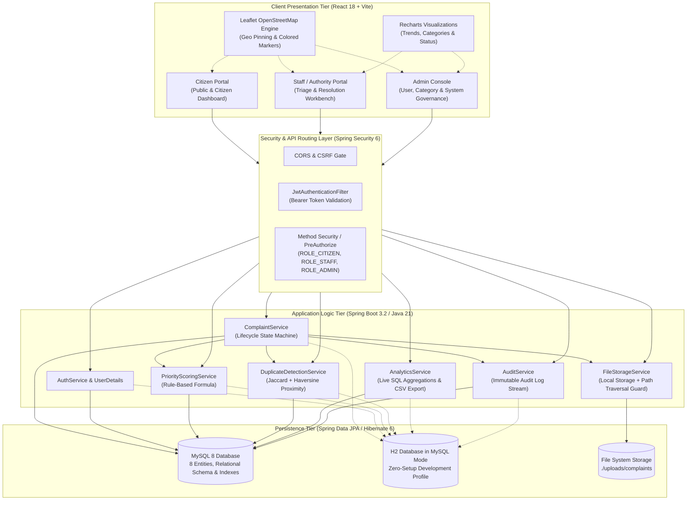
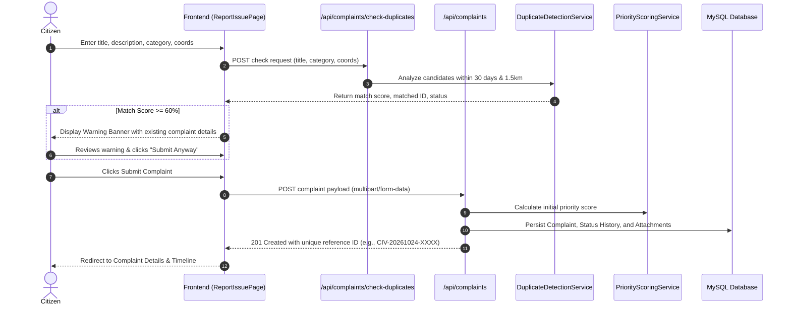
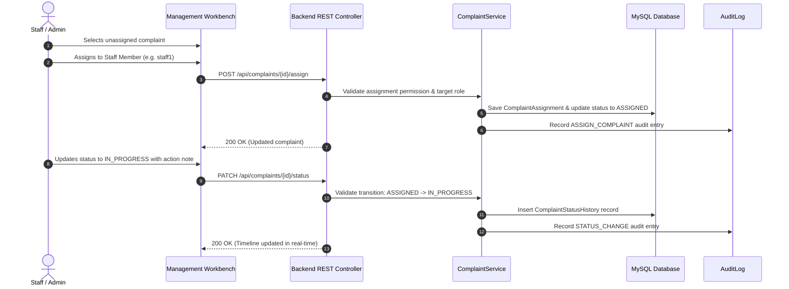

# CivicFix — System Architecture & Design Specification

## 1. System Overview

**CivicFix** is an enterprise-grade, internship-ready Smart Public Issue Reporting & Resolution Platform designed to bridge the civic gap between citizens and municipal authorities. It provides an end-to-end digital complaint lifecycle management system featuring explainable rule-based priority scoring, token-based similarity and geospatial duplicate detection, interactive mapping, real-time workload management, and executive analytics.

---

## 2. Technology Stack Breakdown

| Tier | Technology | Version | Purpose / Responsibilities |
| :--- | :--- | :--- | :--- |
| **Frontend Framework** | React.js (Vite) | 18.3.1 / Vite 5.4 | Component-based SPA architecture, sub-second HMR |
| **Routing & Auth** | React Router DOM | 6.26.2 | Client-side routing, protected routes, role-based guards |
| **HTTP Client** | Axios | 1.7.7 | REST API communication with Bearer token interceptors |
| **Styling & Icons** | Tailwind CSS / Lucide | 3.4 / 0.441 | Utility-first responsive design system, Lucide SVG icons |
| **Geospatial Mapping** | Leaflet / React-Leaflet | 1.9.4 / 4.2.1 | OpenStreetMap raster tiles, GPS pin selection, clustering |
| **Visual Analytics** | Recharts | 2.12.7 | Composable charts (Area trends, Bar distribution, Donut pie) |
| **Backend Runtime** | Java JDK | 21 LTS | High-performance modern virtual machine |
| **Framework Core** | Spring Boot | 3.2.0 | Spring Web MVC, Dependency Injection, Auto-configuration |
| **Security Framework** | Spring Security | 6.x | Stateless session, BCrypt password hashing, JWT RBAC |
| **Token Specification** | JJWT (Java JWT) | 0.12.3 | HMAC-SHA256 compact JWT creation and verification |
| **Data Access / ORM** | Spring Data JPA / Hibernate | 6.x | Object-relational mapping, custom JPQL queries, caching |
| **Validation** | Jakarta Bean Validation | 3.0 | Input constraints, declarative DTO validation rules |
| **Primary Database** | MySQL Server | 8.0+ | Production ACID compliance, foreign keys, btree indexing |
| **Dev / Test Database** | H2 Database Engine | 2.2 | In-memory MySQL emulation for instant zero-dependency launch |

---

## 3. Layered Design & Architectural Principles

CivicFix enforces clean separation of concerns through an enterprise multi-tier architecture:

### 3.1 Presentation Tier (`frontend/src/`)
- **`pages/`**: 16 dedicated views encompassing public landing, citizen self-service, authority queue management, executive admin panels, interactive maps, and analytics.
- **`components/`**: Reusable modular widgets including `ProtectedRoute`, `StatusBadge`, `SeverityBadge`, `PriorityBadge`, `Timeline`, `MapPicker`, `ComplaintsMap`, and `AssignStatusModal`.
- **`context/`**: Centralized `AuthContext` managing authentication state, current user roles, login/logout transitions, and session persistence in `localStorage`.
- **`api/client.js`**: Centralized Axios instance intercepting all outbound HTTP requests to append `Authorization: Bearer <token>`, with proactive 401 handling.

### 3.2 Security & Gateway Tier (`backend/src/main/java/com/civicfix/security/`)
- **`JwtTokenProvider`**: Generates and parses secure HMAC-SHA256 JWT tokens with configurable TTL (default 24 hours).
- **`JwtAuthenticationFilter`**: Intercepts requests, validates Bearer tokens against the secret key, extracts user claims, and loads `UserPrincipal` into Spring's `SecurityContextHolder`.
- **`SecurityConfig`**: Enforces HTTP security policy, declares public endpoints (`/api/auth/**`, `/uploads/**`), configures permissive CORS for frontend ports (5173, 3000), disables CSRF for stateless REST operations, and enables `@EnableMethodSecurity`.

### 3.3 Controller Layer (`backend/src/main/java/com/civicfix/controller/`)
- Thin REST endpoints returning standard `ResponseEntity<ApiResponse<T>>` envelopes.
- Employs Jakarta `@Valid` annotations on incoming DTOs to enforce strict payload constraints before service execution.
- Enforces role requirements declaratively using `@PreAuthorize("hasRole('ADMIN')")` and related role checks.

### 3.4 Service Layer (`backend/src/main/java/com/civicfix/service/`)
- **`PriorityScoringService`**: Rule-based priority engine calculating urgency based on severity weight, complaint age (capped), and category weight.
- **`DuplicateDetectionService`**: Explainable candidate retrieval and similarity scoring combining token Jaccard similarity and Haversine geo-distance.
- **`ComplaintService`**: Central orchestrator managing the complaint lifecycle state machine, validation of valid state transitions, automatic assignment recording, and timeline audit logs.
- **`FileStorageService`**: Validates MIME types (JPEG, PNG, WEBP), file size (max 5MB), prevents path traversal attacks, and stores attachments safely on disk.
- **`AnalyticsService`**: Executes database-level aggregation queries for real-time reporting and compiles streaming CSV exports.
- **`AuditService`**: Asynchronously captures auditable platform activities with actor, client IP, action type, and JSON metadata.

### 3.5 Persistence Layer (`backend/src/main/java/com/civicfix/repository/`)
- Spring Data JPA repositories with optimized JPQL queries avoiding N+1 query overhead.
- Supports multi-parameter filtering, coordinate bounding box search, and pagination.

---

## 4. End-to-End Data Flows

### 4.1 Citizen Issue Reporting & Duplicate Detection Flow

### 4.2 Complaint Assignment & Status Lifecycle Flow

---

## 5. Security & Access Control Matrix

| Endpoint Route | HTTP Method | ROLE_CITIZEN | ROLE_STAFF | ROLE_ADMIN |
| :--- | :---: | :---: | :---: | :---: |
| `/api/auth/**` | POST | Public | Public | Public |
| `/api/complaints` | POST | Allowed | Allowed | Allowed |
| `/api/complaints` | GET | Own Reports Only | All Complaints | All Complaints |
| `/api/complaints/{id}` | GET | Own Reports Only | Allowed | Allowed |
| `/api/complaints/{id}` | PUT | Allowed (SUBMITTED only) | Denied | Denied |
| `/api/complaints/{id}` | DELETE | Allowed (SUBMITTED only) | Denied | Allowed |
| `/api/complaints/{id}/assign` | POST | Denied | Allowed | Allowed |
| `/api/complaints/{id}/status` | PATCH | Denied | Allowed | Allowed |
| `/api/complaints/{id}/comments` | POST | Allowed | Allowed | Allowed |
| `/api/complaints/{id}/reopen` | POST | Allowed (RESOLVED only) | Allowed | Allowed |
| `/api/analytics/**` | GET | Denied | Allowed | Allowed |
| `/api/analytics/export` | GET | Denied | Allowed | Allowed |
| `/api/categories/**` | GET | Allowed | Allowed | Allowed |
| `/api/categories/**` | POST/PUT/DELETE | Denied | Denied | Allowed |
| `/api/users/**` | GET/POST/PUT | Denied | Denied | Allowed |
