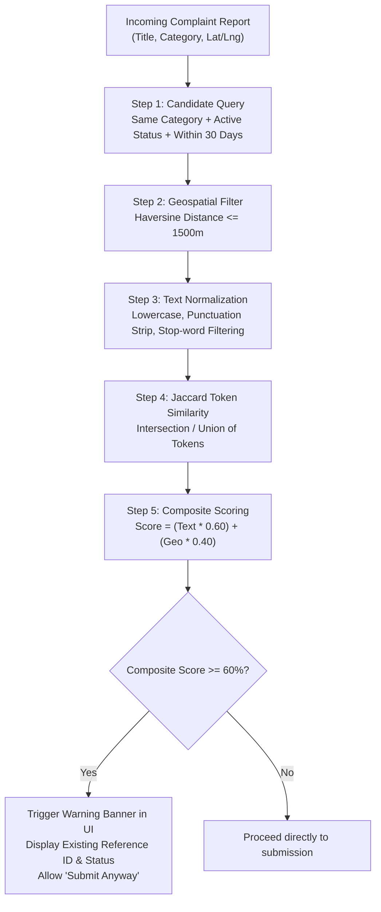

# CivicFix — Duplicate Complaint Detection Algorithm

> [!NOTE]
> The CivicFix duplicate detection system is a **deterministic, explainable algorithm** combining token-based Jaccard similarity and geospatial Haversine proximity. It does not require paid external APIs, OpenAI credits, or remote cloud services.

---

## 1. Overview & Architectural Goals

In municipal issue reporting, citizens frequently file duplicate reports for prominent incidents (e.g., a burst water main on a busy intersection). Duplicate detection in CivicFix serves two critical objectives:
1. **Reduce Departmental Triage Fatigue**: Cluster related reports to avoid dispatching multiple redundant work crews.
2. **Empower Citizens Without Silencing Them**: Warn citizens that their issue has already been logged and is being tracked, while offering a clear **"Submit Anyway"** option if their report represents a distinct incident. **CivicFix never silently discards user reports.**



---

## 2. Mathematical Components

### 2.1 Textual Token-Based Jaccard Similarity
Incoming and existing complaint titles and descriptions are tokenized:
1. Converted to lowercase.
2. Non-alphanumeric punctuation stripped.
3. Common civic stop-words removed (`the`, `a`, `an`, `is`, `on`, `in`, `at`, `of`, `to`, `and`, `for`, `near`, `by`).
4. Unique token sets $A$ and $B$ are extracted.

The Jaccard similarity coefficient $J(A, B)$ is calculated as the size of the intersection divided by the size of the union:

$$J(A, B) = \frac{|A \cap B|}{|A \cup B|}$$

### 2.2 Geospatial Proximity (Haversine Formula)
When GPS coordinates are provided on both reports, the great-circle surface distance $d$ in meters between $(\phi_1, \lambda_1)$ and $(\phi_2, \lambda_2)$ is calculated using the Haversine formula:

$$a = \sin^2\left(\frac{\Delta \phi}{2}\right) + \cos(\phi_1) \cdot \cos(\phi_2) \cdot \sin^2\left(\frac{\Delta \lambda}{2}\right)$$

$$c = 2 \cdot \operatorname{atan2}\left(\sqrt{a}, \sqrt{1 - a}\right)$$

$$d = R \cdot c$$

Where:
- $R \approx 6{,}371{,}000\text{ meters}$ (mean radius of Earth).
- $\Delta \phi = \phi_2 - \phi_1$ in radians.
- $\Delta \lambda = \lambda_2 - \lambda_1$ in radians.

The geographic proximity score $S_{\text{geo}} \in [0, 1]$ decays linearly with distance up to a 500-meter radius:

$$S_{\text{geo}} = \max\left(0,\, 1.0 - \frac{d}{500}\right)$$

*(If coordinates are omitted, $S_{\text{geo}}$ defaults to $0.5$ for same-category reports).*

### 2.3 Composite Match Score
The final composite percentage match score is computed as:

$$\text{Composite Score} = \left(0.60 \times J(A, B) + 0.40 \times S_{\text{geo}}\right) \times 100\%$$

---

## 3. Thresholds & UX Rules

- **Potential Duplicate Threshold**: **$60\%$ composite score**.
- **Active Status Filter**: Only matches against active, unresolved complaints (`SUBMITTED`, `ASSIGNED`, `IN_PROGRESS`, `REOPENED`). Resolved complaints are excluded from duplicate alerts.
- **Explainability**: The response returned to the frontend includes:
  - Exact percentage match score.
  - Matched complaint reference ID (e.g., `CIV-20261024-0001`).
  - Matched complaint title and current status.
  - Calculated physical distance in meters.
- **Citizen Autonomy**: The UI presents an alert banner with a button stating *"A similar issue is already being addressed. If your issue is different or needs a separate report, you can still submit."*

---

## 4. Source Code Implementation Reference

Implemented in [`DuplicateDetectionService.java`](file:///c:/Users/ASUS/OneDrive/Desktop/Smart%20Public%20Issue%20Reporting%20&%20Resolution%20Platform/backend/src/main/java/com/civicfix/service/DuplicateDetectionService.java):

```java
public double calculateHaversineDistance(double lat1, double lon1, double lat2, double lon2) {
    double dLat = Math.toRadians(lat2 - lat1);
    double dLon = Math.toRadians(lon2 - lon1);
    double a = Math.sin(dLat / 2) * Math.sin(dLat / 2) +
               Math.cos(Math.toRadians(lat1)) * Math.cos(Math.toRadians(lat2)) *
               Math.sin(dLon / 2) * Math.sin(dLon / 2);
    double c = 2 * Math.atan2(Math.sqrt(a), Math.sqrt(1 - a));
    return EARTH_RADIUS_METERS * c;
}

public double calculateJaccardSimilarity(String s1, String s2) {
    Set<String> tokens1 = tokenize(s1);
    Set<String> tokens2 = tokenize(s2);
    if (tokens1.isEmpty() || tokens2.isEmpty()) return 0.0;
    Set<String> intersection = new HashSet<>(tokens1);
    intersection.retainAll(tokens2);
    Set<String> union = new HashSet<>(tokens1);
    union.addAll(tokens2);
    return (double) intersection.size() / union.size();
}
```
