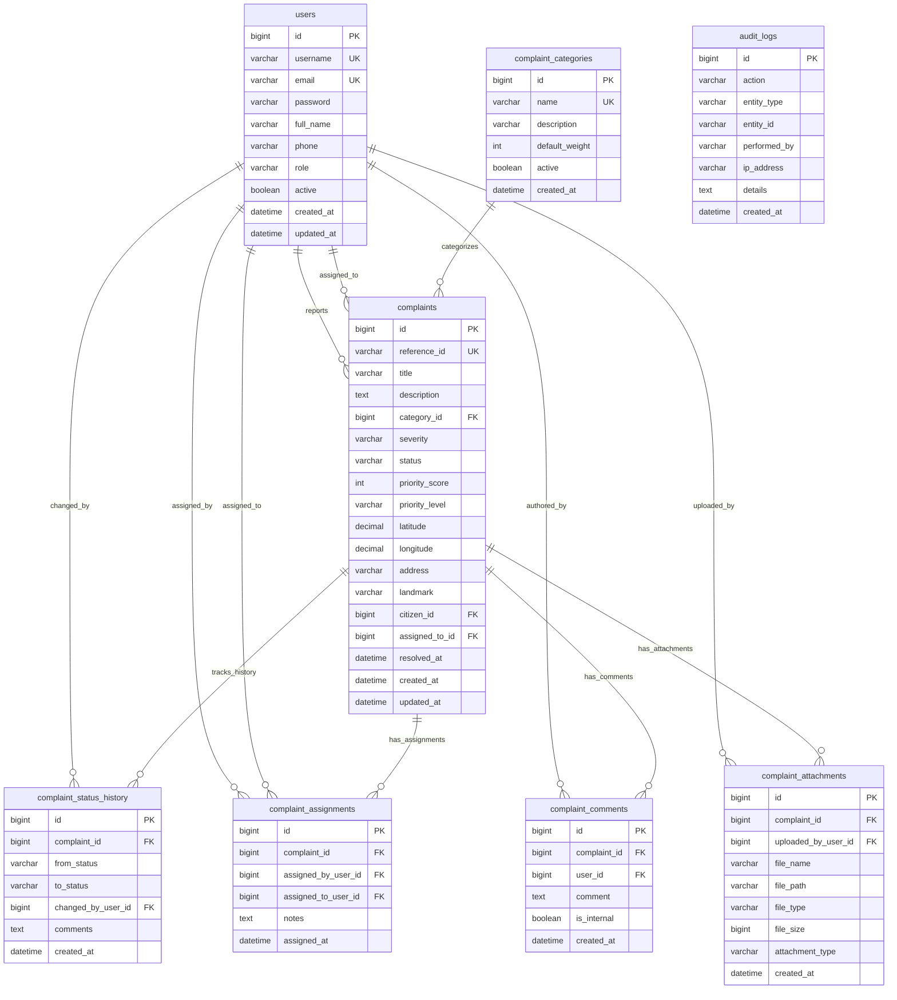

# CivicFix — Entity-Relationship (ER) Data Model

## 1. Relational Entity-Relationship Diagram

---

## 2. Table Specifications & Constraints

### 2.1 `users`
Stores system accounts for Citizens, Authority Staff, and Administrators.
- `id` (BIGINT AUTO_INCREMENT, PRIMARY KEY)
- `username` (VARCHAR(50) NOT NULL UNIQUE)
- `email` (VARCHAR(100) NOT NULL UNIQUE)
- `password` (VARCHAR(255) NOT NULL) — BCrypt hash
- `full_name` (VARCHAR(100) NOT NULL)
- `phone` (VARCHAR(20))
- `role` (VARCHAR(20) NOT NULL) — `ROLE_CITIZEN`, `ROLE_STAFF`, `ROLE_ADMIN`
- `active` (BOOLEAN NOT NULL DEFAULT TRUE)
- `created_at`, `updated_at` (DATETIME NOT NULL)
- **Indexes**: `idx_users_role` on `(role)`, `idx_users_email` on `(email)`.

### 2.2 `complaint_categories`
Configurable municipal issue domains with customizable weights for priority calculation.
- `id` (BIGINT AUTO_INCREMENT, PRIMARY KEY)
- `name` (VARCHAR(100) NOT NULL UNIQUE)
- `description` (VARCHAR(255))
- `default_weight` (INT NOT NULL DEFAULT 10) — Range: 1 to 50
- `active` (BOOLEAN NOT NULL DEFAULT TRUE)
- `created_at` (DATETIME NOT NULL)

### 2.3 `complaints`
Core domain entity representing public issue reports.
- `id` (BIGINT AUTO_INCREMENT, PRIMARY KEY)
- `reference_id` (VARCHAR(30) NOT NULL UNIQUE) — Format: `CF-YYYY-MM-XXXX` (e.g., `CF-2026-10-0001`)
- `title` (VARCHAR(200) NOT NULL)
- `description` (TEXT NOT NULL)
- `category_id` (BIGINT NOT NULL, FK -> `complaint_categories.id`)
- `severity` (VARCHAR(20) NOT NULL) — `LOW`, `MEDIUM`, `HIGH`, `CRITICAL`
- `status` (VARCHAR(20) NOT NULL) — `SUBMITTED`, `ASSIGNED`, `IN_PROGRESS`, `RESOLVED`, `REOPENED`
- `priority_score` (INT NOT NULL DEFAULT 0) — Computed rule-based score (10–130)
- `priority_level` (VARCHAR(20) NOT NULL DEFAULT 'MEDIUM') — `LOW`, `MEDIUM`, `HIGH`, `CRITICAL`
- `latitude` (DECIMAL(10, 8)) — WGS84 latitude coordinate
- `longitude` (DECIMAL(11, 8)) — WGS84 longitude coordinate
- `address` (VARCHAR(255))
- `landmark` (VARCHAR(100))
- `citizen_id` (BIGINT NOT NULL, FK -> `users.id`)
- `assigned_to_id` (BIGINT NULL, FK -> `users.id`)
- `resolved_at` (DATETIME NULL)
- `created_at`, `updated_at` (DATETIME NOT NULL)
- **Indexes**:
  - `idx_complaints_status` on `(status)`
  - `idx_complaints_severity` on `(severity)`
  - `idx_complaints_citizen` on `(citizen_id)`
  - `idx_complaints_assigned` on `(assigned_to_id)`
  - `idx_complaints_category` on `(category_id)`
  - `idx_complaints_created_at` on `(created_at)`
  - `idx_complaints_lat_lng` on `(latitude, longitude)`

### 2.4 `complaint_status_history`
Chronological status transition timeline.
- `id` (BIGINT AUTO_INCREMENT, PRIMARY KEY)
- `complaint_id` (BIGINT NOT NULL, FK -> `complaints.id` ON DELETE CASCADE)
- `from_status` (VARCHAR(20))
- `to_status` (VARCHAR(20) NOT NULL)
- `changed_by_user_id` (BIGINT NOT NULL, FK -> `users.id`)
- `comments` (TEXT)
- `created_at` (DATETIME NOT NULL)

### 2.5 `complaint_assignments`
Staff assignment and re-delegation ledger.
- `id` (BIGINT AUTO_INCREMENT, PRIMARY KEY)
- `complaint_id` (BIGINT NOT NULL, FK -> `complaints.id` ON DELETE CASCADE)
- `assigned_by_user_id` (BIGINT NOT NULL, FK -> `users.id`)
- `assigned_to_user_id` (BIGINT NOT NULL, FK -> `users.id`)
- `notes` (TEXT)
- `assigned_at` (DATETIME NOT NULL)

### 2.6 `complaint_comments`
Discussion and resolution commentary thread.
- `id` (BIGINT AUTO_INCREMENT, PRIMARY KEY)
- `complaint_id` (BIGINT NOT NULL, FK -> `complaints.id` ON DELETE CASCADE)
- `user_id` (BIGINT NOT NULL, FK -> `users.id`)
- `comment` (TEXT NOT NULL)
- `is_internal` (BOOLEAN NOT NULL DEFAULT FALSE)
- `created_at` (DATETIME NOT NULL)

### 2.7 `complaint_attachments`
Uploaded issue photos and resolution evidence references.
- `id` (BIGINT AUTO_INCREMENT, PRIMARY KEY)
- `complaint_id` (BIGINT NOT NULL, FK -> `complaints.id` ON DELETE CASCADE)
- `uploaded_by_user_id` (BIGINT NOT NULL, FK -> `users.id`)
- `file_name` (VARCHAR(255) NOT NULL)
- `file_path` (VARCHAR(500) NOT NULL)
- `file_type` (VARCHAR(50))
- `file_size` (BIGINT)
- `attachment_type` (VARCHAR(50) DEFAULT 'ISSUE_PHOTO') — `ISSUE_PHOTO`, `RESOLUTION_EVIDENCE`
- `created_at` (DATETIME NOT NULL)

### 2.8 `audit_logs`
Immutable security and governance event log.
- `id` (BIGINT AUTO_INCREMENT, PRIMARY KEY)
- `action` (VARCHAR(100) NOT NULL)
- `entity_type` (VARCHAR(50))
- `entity_id` (VARCHAR(100))
- `performed_by` (VARCHAR(50))
- `ip_address` (VARCHAR(45))
- `details` (TEXT)
- `created_at` (DATETIME NOT NULL)
- **Indexes**: `idx_audit_performed_by` on `(performed_by)`, `idx_audit_action` on `(action)`.

### 2.9 `complaint_sequences`
Database-backed sequence table ensuring concurrency-safe, monotonic reference ID generation across restarts and cluster nodes.
- `sequence_key` (VARCHAR(30) PRIMARY KEY) — Key for time bucket (e.g. `CF-2026-10`)
- `current_value` (BIGINT NOT NULL) — Current sequence counter value
