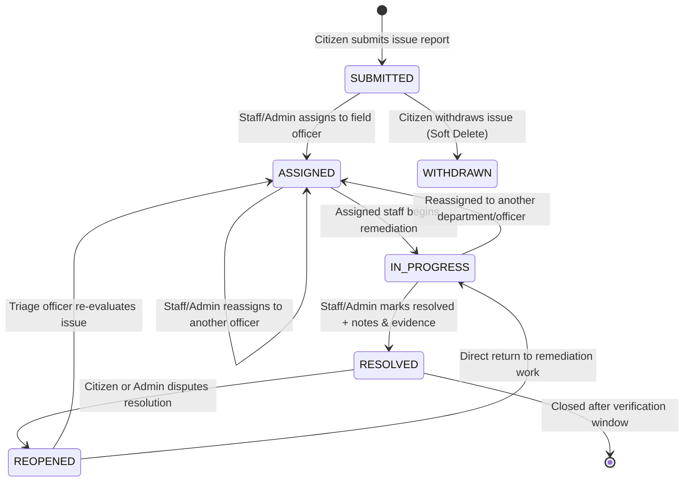

# CivicFix — Complaint Lifecycle & Workflow State Machine

## 1. Overview

The CivicFix complaint lifecycle provides a deterministic, transparent, and auditable status progression. Every status change is validated on the backend by `com.civicfix.enums.ComplaintStatus` and `ComplaintService`, guaranteeing that complaints cannot bypass required operational steps.

---

## 2. State Machine Diagram



---

## 3. Allowed Transition Matrix

The table below outlines the backend-enforced transition rules implemented in `ComplaintStatus.canTransitionTo(ComplaintStatus target)`:

| Current Status | Permitted Target Status | Permitted Actors | Conditions & Validation Rules |
| :--- | :--- | :--- | :--- |
| **`SUBMITTED`** | `ASSIGNED` | Authority / Staff, Admin | Requires valid `assignedToUserId`. Target user must hold `ROLE_STAFF` or `ROLE_ADMIN`. |
| **`SUBMITTED`** | *Withdrawn / Deleted* | Citizen (Reporter only) | Citizen can withdraw their complaint only while it remains in `SUBMITTED` status. |
| **`ASSIGNED`** | `IN_PROGRESS` | Assigned Staff, Admin | Work has begun; optional comment explaining immediate steps. |
| **`ASSIGNED`** | `ASSIGNED` *(Reassign)* | Authority / Staff, Admin | Reassigns complaint to a different staff member; records change in `complaint_assignments`. |
| **`IN_PROGRESS`**| `RESOLVED` | Assigned Staff, Admin | Requires resolution comments; optional photographic evidence attached. |
| **`IN_PROGRESS`**| `ASSIGNED` *(Escalate)* | Authority / Staff, Admin | Permits reassignment if additional equipment or specialized staff is needed. |
| **`RESOLVED`** | `REOPENED` | Citizen (Reporter), Admin | Permitted when citizen indicates issue was not remediated or recurred. Requires explanation comment. |
| **`REOPENED`** | `ASSIGNED`, `IN_PROGRESS` | Authority / Staff, Admin | Fast-tracks reassignment or immediate resumption of repair efforts. |

---

## 4. Backend Transition Guard Implementation

The integrity of this lifecycle is guaranteed at the domain layer in `com.civicfix.enums.ComplaintStatus`:

```java
public boolean canTransitionTo(ComplaintStatus target) {
    if (target == null) return false;
    return switch (this) {
        case SUBMITTED -> target == ASSIGNED;
        case ASSIGNED -> target == IN_PROGRESS || target == ASSIGNED;
        case IN_PROGRESS -> target == RESOLVED || target == ASSIGNED;
        case RESOLVED -> target == REOPENED;
        case REOPENED -> target == ASSIGNED || target == IN_PROGRESS;
    };
}
```

Whenever an invalid status change is attempted (e.g., trying to jump directly from `SUBMITTED` to `RESOLVED`), the backend rejects the request immediately with `HTTP 400 Bad Request`:

```json
{
  "success": false,
  "message": "Invalid status transition from SUBMITTED to RESOLVED",
  "data": null,
  "timestamp": "2026-10-24T20:40:00"
}
```

---

## 5. Timeline Audit Trail Details

Every lifecycle event automatically generates two distinct persistence records:

1. **`complaint_status_history`**:
   - `complaint_id`: Foreign key reference to complaint.
   - `from_status`: Status before the change.
   - `to_status`: New operational status.
   - `changed_by_user_id`: Foreign key reference to actor.
   - `comments`: Optional resolution notes or operational instructions.
   - `created_at`: Exact timestamp recorded by system clock.

2. **`audit_logs`**:
   - `action`: `STATUS_CHANGE`, `ASSIGN_COMPLAINT`, `REOPEN_COMPLAINT`.
   - `entity_type`: `Complaint`.
   - `entity_id`: Human-readable reference ID (e.g., `CIV-20261024-XXXX`).
   - `performed_by`: Username of actor.
   - `ip_address`: Client IP address from HTTP request headers.
   - `details`: JSON payload capturing old and new state.

This double-audit mechanism ensures full accountability, public transparency for citizens, and tamper-resistant audit logs for municipal oversight.
